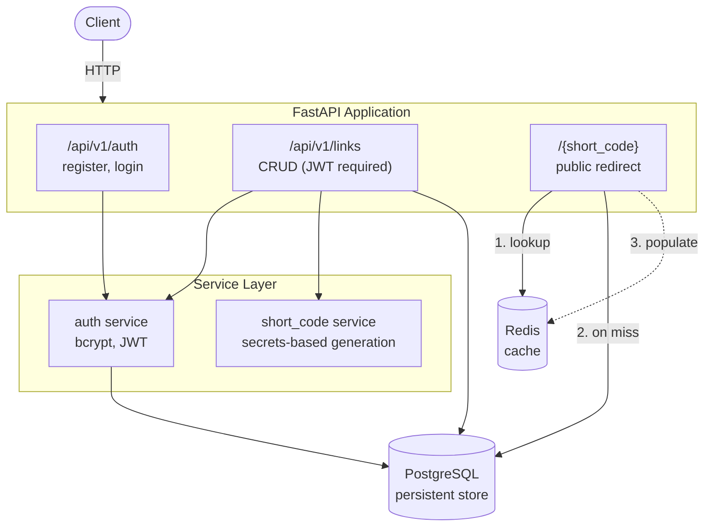
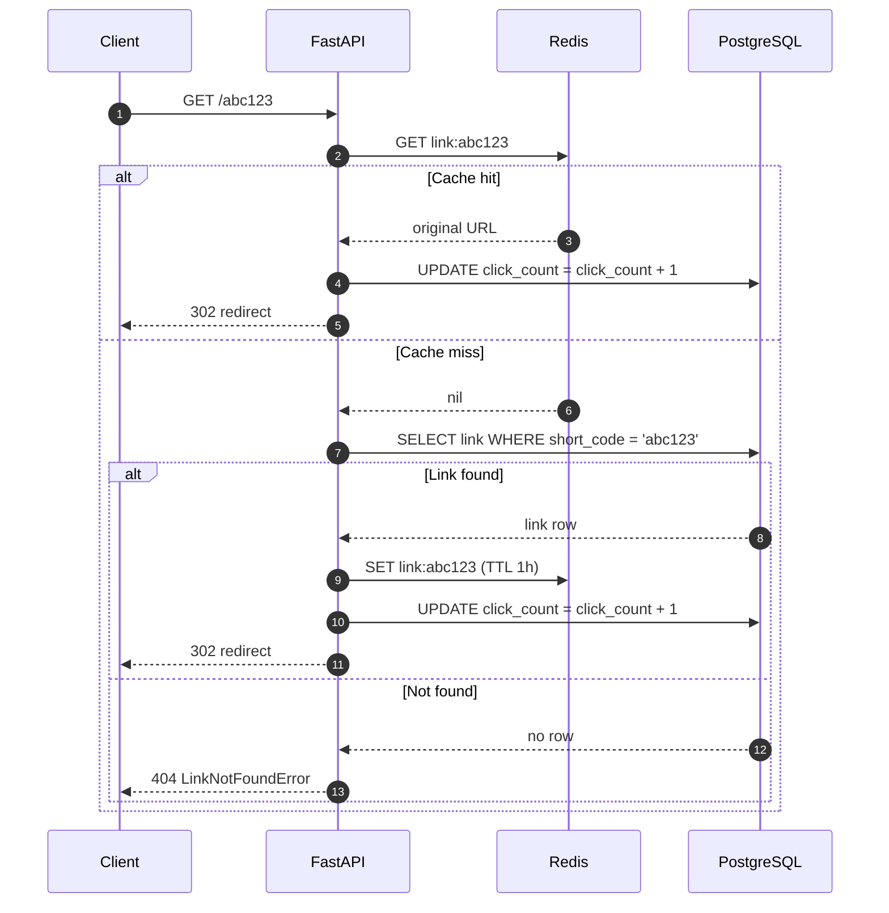
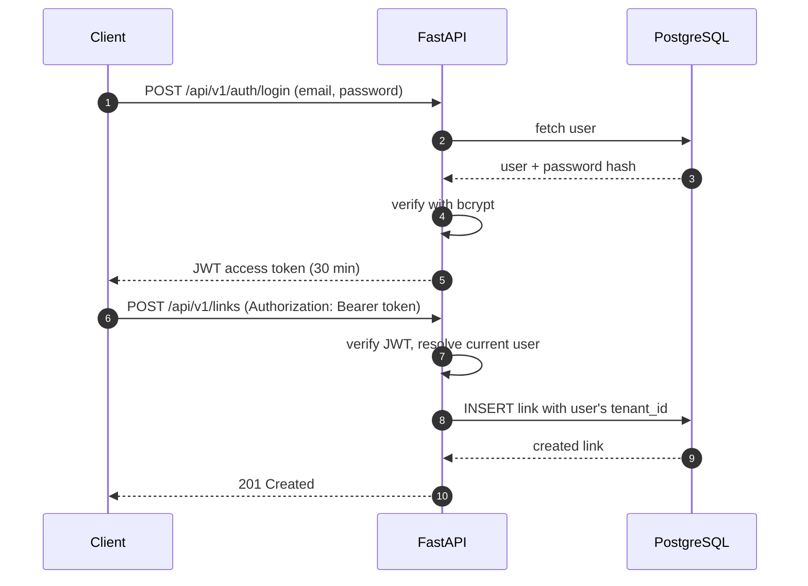
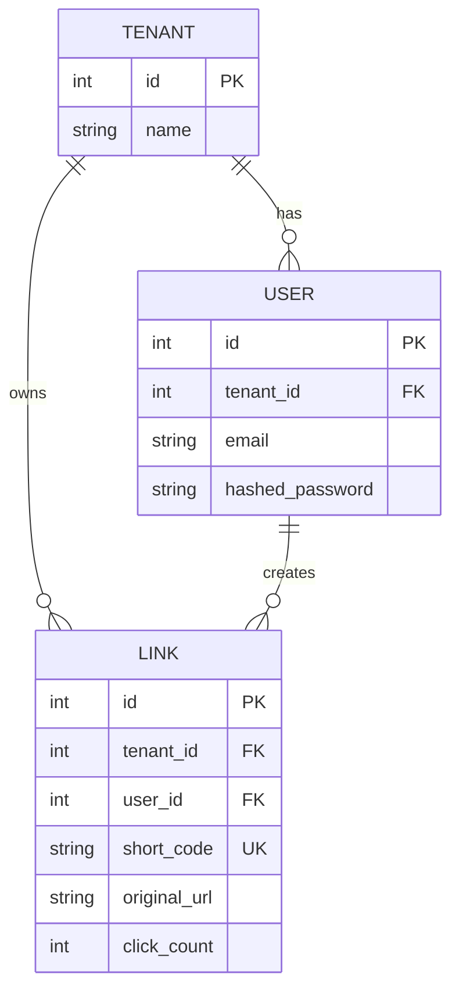

# URL Shortener

A multi-tenant URL shortener built with **FastAPI**, **PostgreSQL**, and **Redis**, using production patterns: JWT auth, tenant isolation, cache-aside redirects, and versioned migrations.

I built this to learn how real backend systems are structured: how authentication works under the hood, how multi-tenant data isolation is enforced, how the redirect hot path can be made fast with caching, and how schema changes are managed safely.


---

## Table of Contents

- [Features](#features)
- [Tech Stack](#tech-stack)
- [Architecture](#architecture)
- [Quick Start](#quick-start)
- [API Overview](#api-overview)
- [The Redirect Hot Path](#the-redirect-hot-path)
- [Design Decisions](#design-decisions)
- [Testing](#testing)
- [Project Structure](#project-structure)
- [Roadmap](#roadmap)

---

## Features

- **User authentication**: registration and login with bcrypt password hashing and JWT access tokens
- **Multi-tenant isolation**: every user belongs to a tenant, and data is scoped at the query level
- **URL shortening**: cryptographically secure short codes generated with `secrets`, not `random`
- **Fast redirects**: Redis cache-aside pattern on the redirect hot path
- **Click tracking**: atomic counter increments with no race conditions
- **Custom short codes**: optional user-provided codes with collision handling
- **Database migrations**: version-controlled schema changes via Alembic
- **Tested**: unit and integration tests with pytest (76% coverage)
- **Containerized**: Docker Compose for API, PostgreSQL, and Redis

## Tech Stack

| Layer | Technology |
|:---|:---|
| Framework | FastAPI |
| Language | Python 3.12 |
| Database | PostgreSQL 16 |
| Cache | Redis 7 |
| ORM | SQLAlchemy 2.0 (async) |
| Migrations | Alembic |
| Auth | JWT (PyJWT) + bcrypt |
| Validation | Pydantic v2 |
| Testing | pytest + pytest-asyncio + httpx |
| Container | Docker + Docker Compose |

---

## Architecture

### System overview



### Redirect request flow



### Authentication and tenant scoping



### Data model



---

## Quick Start

**Prerequisites:** Docker and Docker Compose.

```bash
# 1. Clone and configure
git clone <your-repo-url>
cd urlshortener
cp .env.example .env        # then edit values, especially the JWT secret

# 2. Start API, PostgreSQL, and Redis
docker compose up --build

# 3. Apply database migrations
docker compose exec api alembic upgrade head
```

The API is now running at `http://localhost:8000`. Interactive OpenAPI docs are served at `http://localhost:8000/docs`.

## API Overview

| Method | Endpoint | Auth | Description |
|:---|:---|:---:|:---|
| `POST` | `/api/v1/auth/register` | No | Create a user account |
| `POST` | `/api/v1/auth/login` | No | Exchange credentials for a JWT |
| `*` | `/api/v1/links` | Yes | Create and manage your tenant's links |
| `GET` | `/{short_code}` | No | Redirect to the original URL |

**Example**

```bash
# Register and log in
curl -X POST http://localhost:8000/api/v1/auth/register \
  -H "Content-Type: application/json" \
  -d '{"email": "me@example.com", "password": "s3cret-passw0rd"}'

curl -X POST http://localhost:8000/api/v1/auth/login \
  -H "Content-Type: application/json" \
  -d '{"email": "me@example.com", "password": "s3cret-passw0rd"}'

# Create a short link
curl -X POST http://localhost:8000/api/v1/links \
  -H "Authorization: Bearer <token>" \
  -H "Content-Type: application/json" \
  -d '{"original_url": "https://example.com/some/long/path"}'

# Follow it
curl -i http://localhost:8000/<short_code>
```

---

## The Redirect Hot Path

The public `/{short_code}` endpoint runs on every click, so it uses a cache-aside pattern: check Redis first, fall back to PostgreSQL on a miss.

```python
CACHE_TTL = 3600  # 1 hour


@router.get("/{short_code}")
async def redirect_to_url(short_code: str):
    """Redirect a short code to its original URL. Public endpoint."""

    # 1. Try Redis first (fast path)
    cache_key = f"link:{short_code}"
    cached_url = await redis_client.get(cache_key)

    if cached_url:
        await _increment_click(short_code)
        return RedirectResponse(
            url=cached_url,
            status_code=status.HTTP_302_FOUND,
        )

    # 2. Cache miss: query PostgreSQL
    async with async_session() as db:
        result = await db.execute(select(Link).where(Link.short_code == short_code))
        link = result.scalar_one_or_none()

        if not link:
            raise LinkNotFoundError(
                message=f"Short code '{short_code}' not found.",
                details={"short_code": short_code},
            )

        # 3. Populate the cache, count the click, and redirect
        await redis_client.set(cache_key, link.original_url, ex=CACHE_TTL)
        await _increment_click(short_code)
        return RedirectResponse(
            url=link.original_url,
            status_code=status.HTTP_302_FOUND,
        )
```

**Known trade-offs**

- A cache hit still performs a PostgreSQL `UPDATE` for the click counter. Buffering counts in Redis (`INCR`) and flushing periodically would remove that write from the hot path.
- Unknown codes are not cached, so repeated lookups of a nonexistent code hit PostgreSQL every time. Negative caching with a short TTL would fix this.
- Short codes are looked up globally (the redirect is public and unauthenticated), so `short_code` is unique across all tenants.

---

## Design Decisions

The engineering choices that shaped this project, and why.

### Why `secrets` instead of `random` for short codes

Python's `random` module uses the Mersenne Twister algorithm, which is deterministic and predictable. Given enough outputs, an attacker can infer the internal state and predict future codes. The `secrets` module reads from the OS's cryptographically secure RNG (`/dev/urandom`), making short codes unpredictable. For anything security-adjacent, `secrets` is the correct choice.

### Why a denormalized `click_count` on the links table

Computing clicks with `SELECT COUNT(*) FROM clicks WHERE link_id = X` is O(clicks per link) on every read, even with an index on `link_id`. Instead, a counter column on the link row is incremented atomically with `UPDATE links SET click_count = click_count + 1`. This trades a small amount of write amplification for constant-time reads. The counter is the source of truth for the click total; a separate `clicks` table (future work) will hold per-event details for analytics.

### Why multi-tenancy via a `tenant_id` column (not separate schemas or databases)

Every row has a `tenant_id`, and every query filters by the authenticated user's tenant. This is simpler to reason about than separate PostgreSQL schemas or databases per tenant, and it scales to thousands of tenants on a single database. The trade-off is that one noisy tenant can affect others, which is acceptable at this stage and mitigatable later with connection pool partitioning or per-tenant rate limits. PostgreSQL row-level security is a possible future hardening step so isolation is enforced by the database, not just by application queries.

### Why JWT over server-side sessions

JWT is stateless. Any API instance can verify a token using the shared secret key without a central session store, which makes horizontal scaling straightforward. The trade-off is that tokens can't be revoked before they expire, mitigated here with short-lived access tokens (30 minutes).

### Why Redis on the redirect path

The `/{short_code}` endpoint runs on every click. PostgreSQL lookups take roughly 5-20 ms depending on load; Redis lookups take under 1 ms. For a read-heavy workload where popular links are clicked repeatedly, that is a 10-100x speedup. A TTL (1 hour) is used instead of explicit invalidation to keep things simple: links change rarely, so a short window of staleness is acceptable.

### Why 302 instead of 301 redirects

A 301 is cached by browsers, so repeat clicks from the same user would never reach the server. That would undercount clicks, and future features like link expiration and deletion would not take effect for anyone who had already visited. A 302 keeps every click observable and every link revocable, at the cost of slightly more traffic.

### Why Alembic over `create_all()`

`Base.metadata.create_all()` only creates tables that don't exist; it doesn't alter existing ones. During development I hit bugs caused by a column defined as `Integer` in the database but `String` in the model. Alembic migrations make every schema change versioned, reviewable, reversible, and repeatable.

---

## Testing

The test suite covers pure functions (short code generation, password hashing) and the full API surface (registration, login, authentication, protected endpoints).

```bash
# Run all tests
pytest -v

# With coverage report
pytest --cov=app --cov-report=term-missing
```

Tests use a separate `urlshortener_test` database. Each test runs in isolation: tables are created and dropped around every test function via fixtures in `tests/conftest.py`. FastAPI's `dependency_overrides` replaces the production database session with the test session, so tests never touch real data.

---

## Project Structure

```text
urlshortener/
├── app/
│   ├── api/v1/            # HTTP endpoints
│   │   ├── api.py         # Router aggregation
│   │   ├── auth.py        # /auth endpoints
│   │   ├── links.py       # /links endpoints
│   │   └── redirect.py    # /{short_code} redirect
│   ├── core/              # Cross-cutting concerns
│   │   ├── config.py      # Settings (Pydantic)
│   │   ├── exceptions.py  # Domain exceptions
│   │   └── handlers.py    # Exception -> HTTP mapping
│   ├── db/                # Database and cache connections
│   │   ├── session.py     # Async SQLAlchemy session
│   │   └── redis.py       # Async Redis client
│   ├── models/            # SQLAlchemy ORM models
│   ├── schemas/           # Pydantic request/response models
│   ├── services/          # Business logic
│   │   ├── auth.py        # Hashing, JWT, get_current_user
│   │   └── short_code.py  # Short code generation
│   └── main.py            # FastAPI app entry point
├── alembic/               # Database migrations
├── tests/                 # Test suite
├── compose.yaml           # Docker Compose
├── requirements.txt       # Python dependencies
└── README.md
```

---

## Roadmap

Planned improvements, roughly in priority order:

- [ ] Structured logging: JSON-formatted logs with request IDs for tracing
- [ ] Rate limiting: per-user and per-endpoint limits to prevent abuse
- [ ] CI/CD pipeline: GitHub Actions running tests on every push
- [ ] Observability: Prometheus metrics and a Grafana dashboard
- [ ] Link analytics: clicks by country, referrer, and time window
- [ ] Production deployment: cloud VM with Nginx reverse proxy and TLS
- [ ] Link expiration: optional TTL per link
- [ ] Link deletion: with cache invalidation
- [ ] Redis-buffered click counting and negative caching for unknown codes